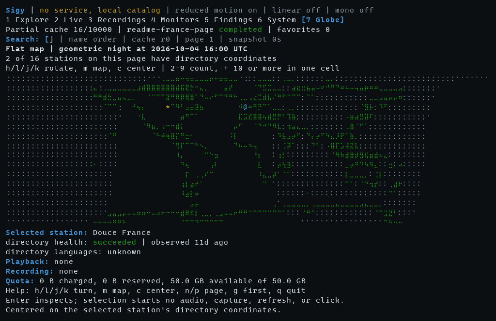

# Sigy

**Practical signals intelligence for everyday people.** Sigy is a local-first listening and analysis toolkit. Explore internet radio and podcasts, keep recordings, read across languages and trace findings back to their sources. Its CLI and terminal explorer share a background service that keeps working when you close the terminal.

**Development preview.** Local speech recognition and English translation run on retained audio, but language quality and broad platform support are not qualified. Windows live and retained listening use a bounded native output helper. An experimental Linux adapter requires a systemd 254+ user session with delegated CPU, memory and PID controllers; unavailable bounds and macOS native work refuse before contact or reservation. See [platform limits](docs/install.md#platform-limits), [current evidence](docs/development/progress.md) and [what comes next](ROADMAP.md#whats-next).



The explorer rendered on 2026-10-04 with one retained real station page. Map positions come from directory metadata; selecting a station does not start playback or recording. [Explore the current controls](docs/usage.md#list-explorer).

## Install

Windows PowerShell:

```powershell
irm https://raw.githubusercontent.com/blisspixel/sigy/main/scripts/install.ps1 -ErrorAction Stop | iex
```

macOS or Linux:

```sh
sh -c 's=$(curl --proto =https --tlsv1.2 -fsS https://raw.githubusercontent.com/blisspixel/sigy/main/scripts/install.sh) && sh -c "$s"'
```

These commands build `main` from source; [installation details](docs/install.md) cover Git, the pinned Rust toolchain, FFmpeg and platform limits.

## What you can do

- **Explore world radio.** Search by station name, country name/code, language or tag. Use `radio search --tag jazz --fetch` to explicitly fill a short cache page, or `sigy tui --country Canada --tag jazz` and `R` then `y`. Press `C` for an offline country picker or `F` to combine filters, browse stations in name order, save favorites and explore a globe or map. Use `sigy play STATION_UUID`, or `P` then `y` in the explorer, to explicitly start a listen. The country reference has 257 entries and names in eight locales; cached station coverage varies.
- **Keep a useful record.** Capture streams in the background, schedule recordings across time zones, and retain selected intervals. Replay an explicit excerpt or exact stored finding through the CLI. Recording timelines distinguish audio, gaps and expired material.
- **Read across languages.** Run experimental local recognition and English translation on retained audio, search originals and translations, and correct a transcript without erasing its history.
- **Follow a topic with evidence.** Bound a monitor's sources and resources, inspect literal matches, and save cited findings and briefings. Finite tasks can collect, process, freeze their exact evidence and publish cited findings with coverage-aware partial results. [Explicit interest withdrawal](docs/decisions/0079-task-interest-withdrawal.md) preserves shared processing. A general task planner remains ahead. Selected operations are available through the [agent plugin](docs/decisions/0021-agent-plugin.md).
- **Desktop status and quick playback.** Inspect ambient service status, directory freshness and active recordings with `sigy panel status`, emit Waybar-compatible JSON with `sigy panel bar`, or launch bounded favorite playback with `sigy panel play` for desktop shells such as Omarchy. Outputs truthfully report qualification boundaries.


The globe uses offline geometry and cached station coordinates. This 2026-10-04 render shows directory observations, not a live coverage survey. Enter inspects a station; `i` reads its exact registrations and recording metadata. Escape restores your search and selection. See [terminal controls and listening](docs/usage.md#list-explorer) and [image provenance](docs/development/interface-images.md).

## Get started

For discovery by chance, use `sigy explore --country Canada` or press `e` in the explorer. Each pick comes from all cached coordinate-bearing stations under the active filters. The globe jumps to its approximate directory position; playing still requires the explicit play action. `g` returns to ordered results.

Create your local library, start the background service and load a first station page:

```text
sigy init --radio
sigy tui
```

For a more useful first page, choose a country and tag: `sigy init --radio --country Canada --tag jazz`. Later, `sigy radio search --country CA --tag jazz --fetch` searches the cache and explicitly requests one matching directory page when needed. `sigy radio refresh --wait` requests a fresh page with an automatic request ID.

Configure your own decoder before listening, then check the local platform:

```text
sigy dvr configure --decoder ABSOLUTE_PATH_TO_FFMPEG
sigy doctor
sigy play STATION_UUID
```

Replace the placeholders with your decoder path and an ID from search. `sigy stop` stops the latest quick listen. The explorer also offers `P`, confirmation with `y`, and `S` to stop; selection and Enter inspection remain passive. Delayed player status replies leave local navigation and quit available. Search and linked metadata reads can still wait for the service. Windows live output uses Sigy's bounded native helper; Linux needs a usable local FFmpeg output and delegated execution. Null decoding and a running receipt do not prove audible output.

Sigy uses `~/.sigy/library` by default. Use `sigy init` for setup without a directory fetch, or `sigy init --no-start` to prepare storage without starting a service. See [first use](docs/install.md#first-use) for custom libraries and recording setup, and the [usage guide](docs/usage.md) for full commands.

Your library and local processing stay on your machine by default. Paid model dispatch is not implemented. The [progress record](docs/development/progress.md#tracked-intermittent-test-issues) keeps known faults and verification gaps visible.

The latest [analysis reliability repair](docs/decisions/0092-atomic-worker-responses.md) preserves exact translation history on replay and prevents a failed response read from leaving a committed claim or result. Automatic recovery of an unsettled worker result remains the next reliability increment.

## Where it's going

A full-screen, retro-futuristic world listening desk with major-city discovery, integrated terminal playback and an interactive radio DVR. Original scripts, chosen qualified translations and cited findings connect discovery to understanding. English remains the implemented translation target; other targets are planned for humans and agents. The [roadmap](ROADMAP.md#whats-next) and [near-term briefs](docs/development/near-term-implementation.md) separate delivered increments from remaining work.

Later work includes [larger libraries and time-aware knowledge](docs/design/storage-and-memory.md), [receive-only SDR and packet sources](docs/design/recording-metadata.md#receive-only-source-qualification), an optional [learning campaign](docs/design/learning-experiences.md) and a rigorous, playful [Strange Signals Desk](docs/design/strange-signals.md). Capacity, language quality and recovery must be measured before support claims.

## Learn more

- [Installation and updates](docs/install.md) and [command reference](docs/usage.md)
- [Reproducible terminal screenshot review](docs/development/visual-qa.md)
- [Current progress and verification evidence](docs/development/progress.md)
- [Product intent](INTENT.md) and [what comes next](ROADMAP.md#whats-next)
- [Near-term build briefs](docs/development/near-term-implementation.md) and [workflow invariants](docs/design/workflow-invariants.md)
- [Architecture, design and research](docs/README.md)

## Use responsibly

Laws about receiving, recording, decoding, storing and sharing signals and broadcasts vary by country and region, and they can differ for internet streams, radio frequencies, encrypted traffic and personal data. You are solely responsible for knowing and following every law, regulation, license condition and terms of service that applies to you, your equipment, your location and your use. Only access sources you are permitted to access, keep hardware receive-only unless you hold the required authorization, and respect privacy and copyright. That a signal can be received does not mean you may record, decode, publish or reuse it. The [usage guide](docs/usage.md#lawful-use) has more detail.

Transcriptions, translations and findings are machine output and can be wrong. Check anything important against the original.

Sigy is provided "as is", without warranty of any kind. The authors and contributors are not liable for any claim, damage or other liability arising from its use or misuse, as set out in the license. Nothing in this project is legal advice.

## License

Copyright 2026 Nick Seal. Sigy is licensed under the [Apache License, Version 2.0](LICENSE), including its warranty disclaimer and limitation of liability. Third-party software and content retain their own licenses and notices. See [contributing](CONTRIBUTING.md) and [security reporting](SECURITY.md).
